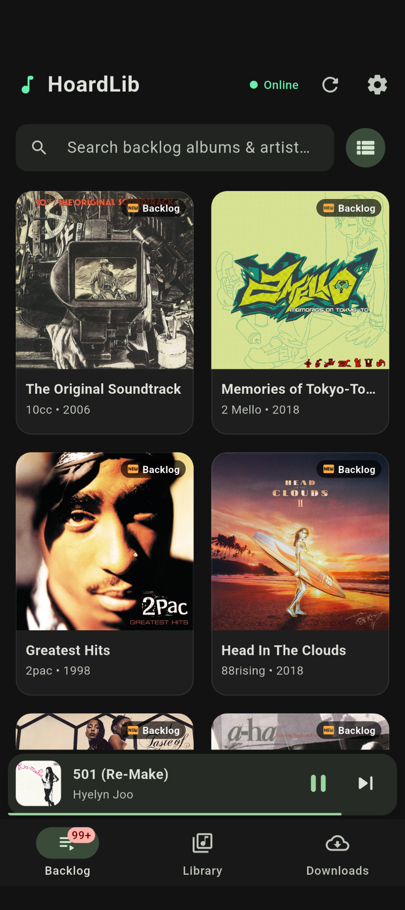
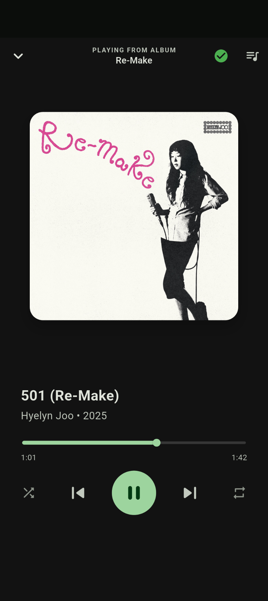

# HoardLib

**HoardLib** is a personal music streaming and backlog tracking system built to manage and listen through my local music collection. It combines a self-hosted Spring Boot backend with a Flutter mobile application, allowing me to stream music from my home server, track listened vs. unlistened albums, and download full albums for offline playback.

---

## Screenshots

<p align="center">
  
  &nbsp;&nbsp;&nbsp;&nbsp;
  
</p>

---

## Features

- **Backlog Tracking**: Track unlistened music across the library and mark albums as listened as they are completed.
- **High-Fidelity Audio Streaming**: Stream lossless and lossy audio formats (MP3, FLAC, M4A/AAC, OGG, OPUS, WAV) with HTTP Range seeking support.
- **Offline Album Downloads**: Stream and download full albums packaged into ZIP archives on-the-fly, extracted automatically on the device for offline playback.
- **Background Playback**: Full background audio with lock-screen media controls and system notifications (`just_audio` & `just_audio_background`).
- **Library Organization**: Automatically indexes artist folders, album release years, track numbers, and local cover artwork (`cover.jpg`).
- **Server Switching**: Configure connections to localhost, Android emulators (`10.0.2.2:8080`), or local network server endpoints on the fly.

---

## Architecture & Tech Stack

| Layer | Tech Stack | Highlights |
|---|---|---|
| **Backend (`/server`)** | Java 21, Spring Boot 4.x, Spring Data JPA, SQLite, Hibernate | Directory scanner, range streaming, ZIP packing, REST API |
| **Mobile (`/app`)** | Flutter (Dart 3.x), Riverpod, `just_audio`, Dio, Archive | Material 3 UI, offline cache management, responsive views |
| **Storage** | SQLite + Local Filesystem | Fast metadata queries and zero external database dependencies |

---

## Expected Music Library Structure

The backend indexes music structured in the following directory layout:

```text
Music/
├── Artist Name/
│   ├── Album Title (Year)/
│   │   ├── cover.jpg
│   │   ├── 01. First Track.mp3
│   │   ├── 02. Second Track.flac
│   │   └── ...
```

- **Album Folder**: `<Album Title> (<Year>)` (e.g. `Memories of Tokyo-To (2018)`)
- **Tracks**: `<Track Number>. <Track Title>.<ext>` (e.g. `01. Pump Up the Love.mp3`)
- **Cover Art**: `cover.jpg` inside the album directory

---

## Getting Started

### 1. Backend Server Setup

#### Prerequisites
- **Java 21** or newer
- Gradle (or use included `./gradlew`)

#### Configuration
1. Navigate to the `server` directory:
   ```bash
   cd server
   ```
2. Copy `.env.example` to `.env` and configure your paths:
   ```bash
   cp .env.example .env
   ```
3. Edit `.env`:
   ```properties
   MUSIC_LIBRARY_PATH=/path/to/your/music/library
   SPRING_DATASOURCE_URL=jdbc:sqlite:music_library.db
   ```

#### Run the Server
```bash
./gradlew bootRun
```
The server will start at `http://localhost:8080` and trigger an initial library scan upon startup.

---

### 2. Mobile App Setup

#### Prerequisites
- **Flutter SDK** (>= 3.12.2)
- Android Studio / Xcode / VS Code

#### Run the App
1. Navigate to the `app` directory:
   ```bash
   cd app
   ```
2. Install dependencies:
   ```bash
   flutter pub get
   ```
3. Launch the application:
   ```bash
   flutter run
   ```
4. Open the in-app **Settings** dialog to point to your server instance (e.g. `http://10.0.2.2:8080` for Android emulator or `http://<your-lan-ip>:8080` for physical devices).

---

## API Endpoints Summary

| Method | Endpoint | Description |
|---|---|---|
| `GET` | `/api/artists` | List all artists with albums & track counts |
| `GET` | `/api/artists/{id}` | Get specific artist details |
| `GET` | `/api/albums` | List albums (supports `?listened=true/false` filter) |
| `GET` | `/api/albums/{id}` | Get album details and track list |
| `PATCH` | `/api/albums/{id}/listened` | Toggle or update listened state |
| `GET` | `/api/albums/{id}/cover` | Fetch album cover artwork |
| `GET` | `/api/albums/{id}/download` | Stream album as on-the-fly uncompressed ZIP |
| `GET` | `/api/tracks/{id}/stream` | Stream audio with HTTP Range support |
| `POST` | `/api/library/scan` | Trigger a manual library re-scan |

---

## Testing

Run backend tests:
```bash
cd server && ./gradlew test
```

Run Flutter tests:
```bash
cd app && flutter test
```

